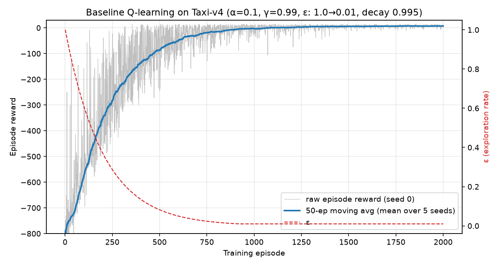

# CPSC 4420 Assignment 2 — Tabular Q-learning on Taxi

A from-scratch tabular Q-learning agent for Gymnasium's **Taxi** environment (`Taxi-v4`, identical to
`Taxi-v3` under default settings), plus hyperparameter studies of the learning rate, the discount
factor, the ε-decay schedule and an action-noise (stochastic environment) experiment.



## Results at a glance

| Policy (greedy, 100 eval episodes) | Mean reward | Success rate | Mean steps |
|---|---|---|---|
| **Best agent** (α=0.9, γ=0.99, ε-decay 0.995, 2000 eps) | **7.91 ± 2.44** | **100%** | 13.1 |
| Baseline (α=0.1, γ=0.99, ε-decay 0.995, 2000 eps) | −33.14 ± 83.45 | 80% | 49.9 |
| Optimal policy (value iteration, reference only) | 7.97 ± 2.36 | 100% | 13.0 |

Video of the best agent: [`results/taxi_agent.mp4`](results/taxi_agent.mp4).
Full write-up: [`report.pdf`](report.pdf). All numbers are in [`results/metrics.json`](results/metrics.json).

## Setup

Requires Python 3.10+.

```bash
python -m venv .venv
# Windows: .venv\Scripts\activate      macOS/Linux: source .venv/bin/activate
pip install -r requirements.txt
```

## Run

```bash
python experiments.py          # parts C-H: trains every config over 5 seeds, writes results/*.png + metrics.json (~10 min)
python experiments.py --seeds 2   # quicker run
python record_video.py         # renders the best agent (results/best_q.npy) to results/taxi_agent.mp4
python make_report.py --name "Your Name" --repo https://github.com/USERNAME/REPO   # rebuilds report.pdf
```

## Files

| File | Purpose |
|---|---|
| `qlearning.py` | `QConfig` (all hyperparameters), `QLearningAgent` (Q-table, ε-greedy, update), `train`, `evaluate`, `NoisyActionWrapper`, value-iteration reference `optimal_q` |
| `experiments.py` | Runs parts C–H and produces all plots and metrics |
| `record_video.py` | Renders the trained greedy policy to MP4 |
| `make_report.py` | Builds `report.pdf` from `results/` |
| `results/` | Plots, `metrics.json`, `best_q.npy` (trained Q-table), `taxi_agent.mp4` |

## Experiments

| Part | What varies | Plot |
|---|---|---|
| C | Baseline α=0.1, γ=0.99, ε 1.0→0.01 (×0.995/episode), 2000 episodes | `results/C_baseline.png` |
| D | α ∈ {0.01, 0.1, 0.5, 0.9} | `results/D_alpha.png` |
| E | γ ∈ {0.5, 0.9, 0.99} | `results/E_gamma.png` |
| F | ε-decay ∈ {0.95, 0.99, 0.995, 0.999} | `results/F_epsilon_decay.png` |
| G | Best-config selection + final 100-episode greedy evaluation | `results/G_candidates.png` |
| H | Action noise p ∈ {0, 0.10, 0.25}: with prob. p the action is replaced by a *different* random action | `results/H_noise_training.png`, `results/H_robustness.png` |

Key findings: a large α learns fastest and stays stable because Taxi is deterministic; γ = 0.5 is too
myopic to find the +20 delivery reward; slower ε-decay trades training reward for better state coverage.
Under action noise a small α is needed, learning slows, and achievable reward drops. The noise-free
policy stays close to optimal under uniform action noise.
